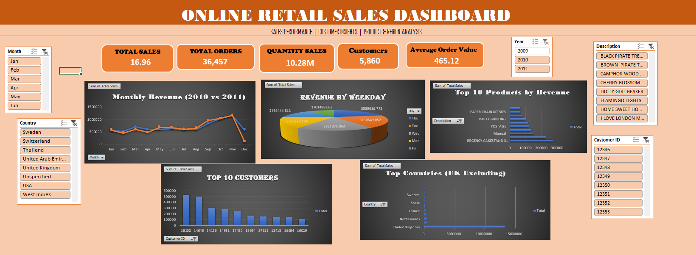

# Online Retail II Sales Analysis

[View full-size dashboard](dashboard.png) · [Download Excel preview](https://github.com/ansavshiju/Excel-Projects/raw/refs/heads/main/Online-Retail-II/Online_Retail_II_Preview.xlsx) · [Findings and recommendations](#findings-and-recommendations) · [Changelog](#changelog)

I used Excel, Power Query, PivotTables, and slicers to analyze retail transactions by time, product, customer, and market. The dashboard image shows the original Excel layout. The slicers are interactive in the full Excel workbook.

## Key metrics

| Metric | Result |
| --- | ---: |
| Revenue | £16,956,900.95 |
| Orders | 36,457 |
| Units sold | 10,282,737 |
| Unique customers | 5,860 |
| Average order value | £465.12 |
| UK share of revenue | 82.62% |

The KPIs cover the full cleaned dataset from 1 December 2009 to 4 December 2011. The saved dashboard charts are filtered to 2010–2011.

## Dashboard charts and filters

| Chart | What it shows |
| --- | --- |
| Monthly Revenue (2010 vs 2011) | Revenue trends across the two years |
| Revenue by Weekday | How weekly revenue is distributed |
| Top 10 Products by Revenue | The highest-revenue product descriptions |
| Top 10 Customers | Customer accounts ranked by revenue |
| Top Countries | Revenue by market. The original screenshot shows the United Kingdom even though the chart title says “UK Excluding.” |

The dashboard includes slicers for **Month, Country, Year, Description, and Customer ID**.

## Data preparation

The source contains 1,048,575 transaction rows. In Power Query, I set column types and filtered rows with missing descriptions or customer IDs, non-positive quantities, or non-positive prices. This left 767,369 rows for the sales analysis. I calculated line revenue as quantity × price and used month, weekday, and year fields to compare sales over time.

## Analysis questions

1. What is the total revenue?
2. How many orders (unique invoices) are there?
3. What is the total quantity sold?
4. How many unique customers are there?
5. What is the average order value?
6. What is the UK’s share of revenue (%)?
7. How does revenue change by month and by year?
8. Which weekday has the highest sales?
9. What are the top 10 products by revenue?
10. Who are the top 10 customers?
11. What are the top 10 countries by revenue?
12. How many orders come from each country?

## Findings and recommendations

| Finding | Recommendation |
| --- | --- |
| Total revenue is £16.96M from 36,457 orders and 5,860 customers. Average order value is £465. | The high order value points to a wholesale (B2B) business – focus on bulk-order offers, bundles and trade discounts. |
| The UK gives 82.6% of revenue (£14.0M). | Protect the UK core market, but reduce dependence on one country by growing export markets. |
| Top export markets are EIRE (£610K), Netherlands (£542K), Germany (£418K) and France (£344K). | Run targeted marketing and shipping offers for these four markets. |
| EIRE earns £610K from only 5 customers; the Netherlands from 22. | Overseas revenue depends on a few big accounts – assign key-account management and add new customers in these markets. |
| Sales are strongly seasonal: Sep–Nov brings 39% (2010) and 40% (2011) of Jan–Nov revenue. November is the peak month (£1.17M in 2010, £1.16M in 2011). | Build stock and staff from August for the Christmas season and start early promotions in September. |
| February is the weakest month (£951K over two years). | Use January–February promotions, clearance sales and new-year offers to lift the low months. |
| Revenue is flat: Jan–Nov 2011 £7.80M vs Jan–Nov 2010 £7.80M (-0.1%). | Growth needs new initiatives – new customers, new products and new markets. |
| Thursday is the best day (21.8% of revenue) and Friday is the lowest working day (15.0%). Saturday has almost no sales (0.06%); Sunday gives 10.4%. | Make sure order-processing capacity is strongest on Thursdays; check whether Saturday is a closure day and consider weekend promotions. |
| 78% of revenue comes between 10:00 and 15:59, with the peak at 12:00. | Keep customer support and website/warehouse capacity strongest at midday; send promotional emails in the morning. |
| Regency Cakestand 3 Tier (£273,694) and White Hanging Heart T-Light Holder (£245,489) are the top revenue products. | Keep best-sellers always in stock and use them in bundles and promotions. |
| World War 2 Gliders is the top product by units (104,116) but is not in the top 10 by revenue (low price, high volume). | Use high-volume low-price items to attract orders and cross-sell higher-value products with them. |
| The top 20% of customers give 77% of revenue; the top 10 customers alone give 15.9%. | Create a VIP/loyalty programme for the top customers and monitor them closely so none are lost. |
| 72% of customers ordered more than once (average 6.2 orders per customer). | Strong repeat buying – reward loyalty and run win-back campaigns for the one-time customers. |
| 18,160 invoice lines (2.3% of the lines with a customer) were cancellations/returns (negative quantity). | Analyse which products and customers have the most cancellations to reduce returns. |
| Non-product lines (Postage, Manual, adjustments) add £302K (1.8% of revenue) and appear in the Top 10 products PivotTable. | Report postage and manual charges separately (or filter them out of the pivot) so product rankings stay accurate. |

## Changelog

| Sheet | Change | Reason | Rows / status |
| --- | --- | --- | --- |
| online_retail_II | Raw data kept untouched in table "Table1": 1,048,575 rows × 13 columns (Invoice, StockCode, Description, Quantity, InvoiceDate, Price, Customer ID, Country, Total Sales, Month, Day, Year, Proper). Data runs from 1 Dec 2009 to 4 Dec 2011. | Original source data – protected from changes | 1,048,575 |
| online_retail_II | Added Total Sales = Quantity × Price (calculated column) | Revenue for every invoice line |  |
| online_retail_II | Added Month, Day, Year and Proper (cleaned product name) columns | To analyse sales by month, weekday and year, and to get clean product names |  |
| Cleaned Data (Power Query) | Loaded the data into Power Query and changed data types (Quantity = whole number, InvoiceDate = date/time, Price = number, Customer ID, Invoice and StockCode = text) | Consistent data types for accurate calculations |  |
| Cleaned Data (Power Query) | Removed rows where Description is blank: 38,415 rows | A line without a product cannot be used for product analysis | – 38,415 |
| Cleaned Data (Power Query) | Removed rows where Customer ID is blank: 224,561 rows | Needed for customer analysis (unique customers, top customers) | – 224,561 |
| Cleaned Data (Power Query) | Kept only Quantity > 0: removed 18,160 rows (cancelled / returned invoices – Invoice starts with "C") | Cancellations have negative quantity and would reduce sales wrongly | – 18,160 |
| Cleaned Data (Power Query) | Kept only Price > 0: removed 70 rows | Zero-price lines are not real sales | – 70 |
| Cleaned Data | Result loaded to sheet "Cleaned Data" (table Table1_1): 767,369 clean rows. Total removed = 281,206 rows (1,048,575 → 767,369) | Final clean dataset used for every calculation, PivotTable and chart | 767,369 |
| Analysis | Listed the 12 business questions answered in this project | To define the scope of the analysis |  |
| Calculation | Calculated total revenue, orders, quantity, unique customers, average order value and UK share | Answers to questions 1–6 |  |
| Calculation | Corrected the formulas for unique orders and unique customers to use the table columns Table1_1[Invoice] and Table1_1[Customer ID]. They counted the header row (and one blank cell): orders showed 36,459 instead of 36,457, customers 5,861 instead of 5,860 and average order value 465.10 instead of 465.12 | Whole-column references (A:A, G:G) include the header and empty cells and over-counted by 1–2 | Fix |
| Pivot Table | Built 6 PivotTables (orders by country, weekday revenue, top 10 countries, top 10 customers, top 10 products, month × year revenue) with 6 slicers (Country, Month, Day, Year, Customer ID, Description) | Answers to questions 7–12 with interactive filters |  |
| Charts | Created 5 PivotCharts: monthly revenue 2010 vs 2011, revenue by weekday, top 10 products, top 10 customers and top countries (UK excluded) | To show the PivotTable results visually |  |
| Dashboard | Built the dashboard: KPI cards (total sales, total orders, average order value, customers, quantity), the 5 PivotCharts and 5 slicers (Country, Month, Year, Customer ID, Description) on one page | One-page summary for presentation |  |
| Dashboard | Corrected the KPI cards to match the corrected Calculation sheet: Total Orders 36,457, Average Order Value 465.12, Customers 5,860 | Dashboard numbers must match the Calculation sheet | Fix |
| Insights & Recommendations | Added 15 insights with matching recommendations | To turn the numbers into business actions |  |

## Project files

The [Excel preview](https://github.com/ansavshiju/Excel-Projects/raw/refs/heads/main/Online-Retail-II/Online_Retail_II_Preview.xlsx) includes the KPI summary, a weekday revenue chart, and the findings. The full 168 MiB workbook contains the raw and cleaned data, Power Query workflow, PivotTables, and interactive dashboard. The full workbook is available from the original attachment in ChatGPT.
